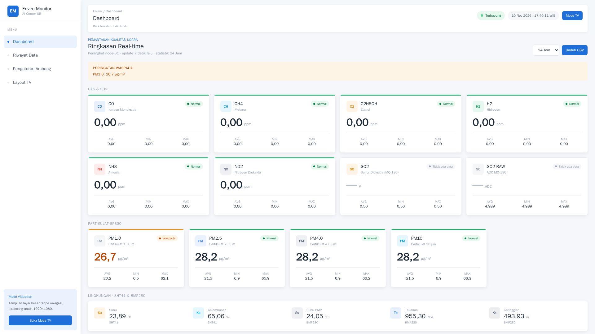
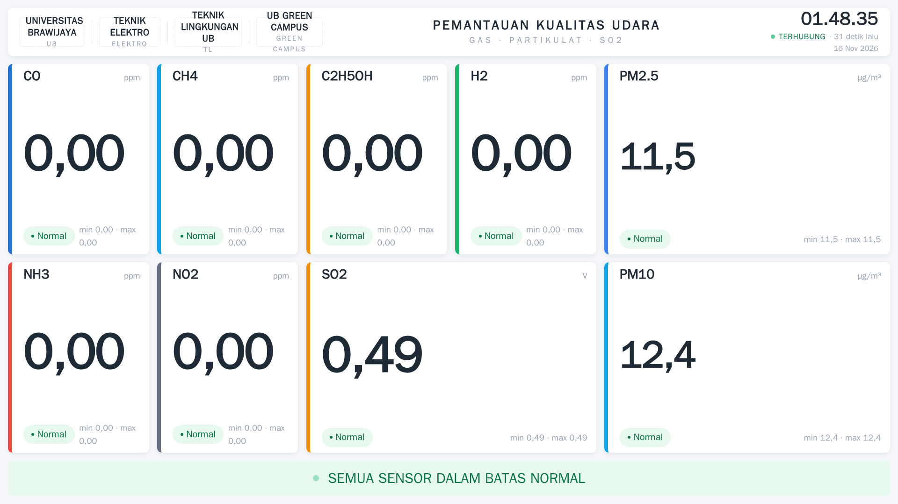
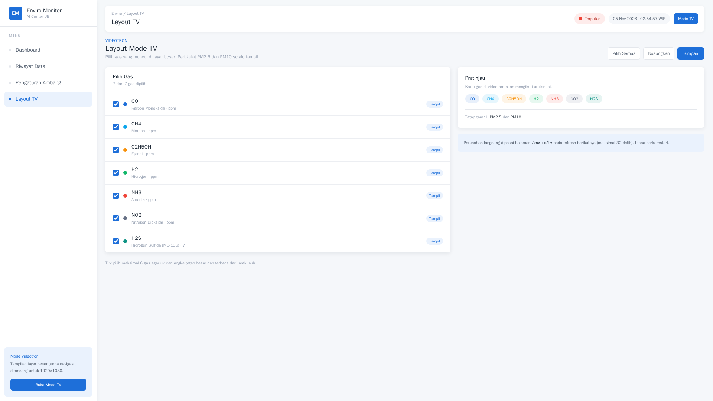
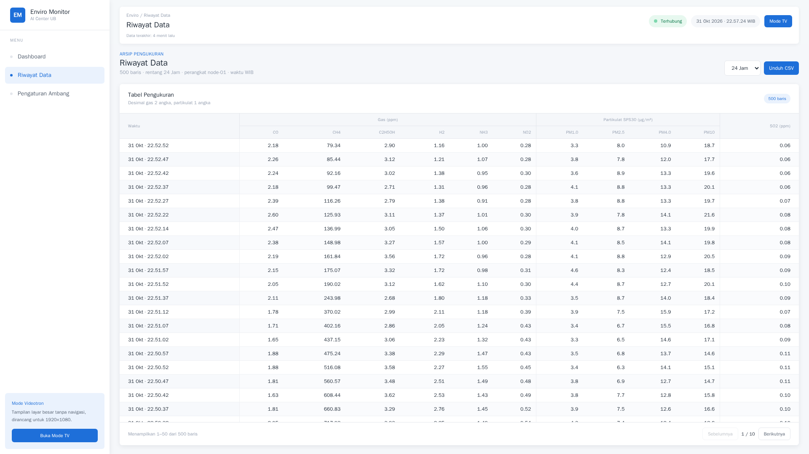

# Enviro Monitor

Dashboard pemantauan kualitas udara untuk operator dan videotron: gas (CO, CH4,
C2H5OH, H2, NH3, NO2), partikulat SPS30 (PM1.0/2.5/4.0/10), SO2 (MQ-136), serta
suhu, kelembapan, tekanan, dan ketinggian (SHT41 + BMP280).

Dibangun dengan Next.js 16, TypeScript, Tailwind CSS v4, dan InfluxDB 2.7,
seluruhnya berjalan di Docker.




## Daftar isi

- [Fitur](#fitur)
- [Arsitektur](#arsitektur)
- [Tech stack](#tech-stack)
- [Prasyarat](#prasyarat)
- [Mulai cepat](#mulai-cepat)
- [Variabel lingkungan](#variabel-lingkungan)
- [Data demo](#data-demo)
- [Node sensor](#node-sensor)
- [Kontrak API](#kontrak-api)
- [Skema InfluxDB](#skema-influxdb)
- [Halaman](#halaman)
- [Layout TV](#layout-tv)
- [Reverse proxy](#reverse-proxy)
- [Ambang batas](#ambang-batas)
- [Struktur proyek](#struktur-proyek)
- [Screenshot](#screenshot)
- [Catatan operasional](#catatan-operasional)
- [Troubleshooting](#troubleshooting)
- [Keamanan](#keamanan)
- [Kontribusi](#kontribusi)

## Fitur

- Dashboard operator real-time: kartu nilai, status warna, AVG/MIN/MAX, grafik historis.
- Alarm otomatis berdasarkan ambang batas yang bisa diubah dari antarmuka.
- Mode videotron `/tv` untuk 1920×1080, tanpa navigasi dan tanpa scrollbar.
- Halaman **Layout TV** untuk memilih gas yang tampil di videotron.
- Riwayat data dengan paginasi, pewarnaan status, dan ekspor CSV siap Excel Indonesia.
- Endpoint ingest HTTP dengan API key, mendukung satu data maupun batch.
- Klien Python untuk Raspberry Pi: parsing blok teks firmware, antrean offline, retry.
- Tema light biru–abu–putih (primary `#1e6fd9`, latar `#f5f7fa`, kartu putih).
- Siap dipasang di sub-path reverse proxy melalui `NEXT_PUBLIC_BASE_PATH`.

## Arsitektur

```
┌──────────────┐   HTTP POST    ┌───────────────┐   Flux   ┌────────────┐
│ Sensor node  │ ─────────────▶ │ Next.js app   │ ───────▶ │ InfluxDB   │
│ (Raspberry)  │  x-api-key     │ /api/ingest   │          │ air_quality│
└──────────────┘                │               │ ◀─────── │            │
                                │  API + UI     │  query   └────────────┘
                                └───────┬───────┘
                                        │ HTTP
                              ┌─────────┴─────────┐
                              │ Browser operator  │
                              │ Browser videotron │
                              └───────────────────┘
```

## Tech stack

| Lapisan | Teknologi |
|---|---|
| Frontend | Next.js 16 (App Router), React 19, Tailwind CSS v4, Recharts |
| Backend | Route Handlers Next.js, Zod, `@influxdata/influxdb-client` |
| Database | InfluxDB 2.7 (bucket `air_quality`, retensi 30 hari) |
| Runtime | Docker + Docker Compose, Node.js 20 |
| Node sensor | Python 3.9+ (stdlib, `pyserial` opsional) |

## Prasyarat

- Docker 24+ dan Docker Compose v2
- Node.js 20+ (hanya untuk build manual / pengembangan)
- Port `3000` (aplikasi) dan `8086` (InfluxDB, lokal) tersedia

## Mulai cepat

```bash
git clone https://github.com/FahmyAlmaliki/enviro_web.git
cd enviro_web

cp .env.example .env
# isi INFLUX_TOKEN, INFLUX_PASSWORD, dan INGEST_API_KEY

docker compose up -d --build
```

Akses:

| Halaman | URL |
|---|---|
| Dashboard | `http://localhost:3000/enviro` |
| Videotron | `http://localhost:3000/enviro/tv` |
| Riwayat | `http://localhost:3000/enviro/riwayat` |
| Pengaturan ambang | `http://localhost:3000/enviro/pengaturan` |
| Layout TV | `http://localhost:3000/enviro/pengaturan/tv` |
| InfluxDB (lokal) | `http://127.0.0.1:8086` |

### Build di mesin kecil

`docker build` yang mengompilasi Next.js bisa memakai RAM besar. Untuk VM kecil:

```bash
npm ci
./scripts/build-runtime.sh
```

Skrip ini mengompilasi di host lalu membungkus hasilnya menjadi image runtime.

## Variabel lingkungan

Salin `.env.example` menjadi `.env`. File `.env` **tidak** ikut di-commit.

| Variabel | Wajib | Default | Keterangan |
|---|---|---|---|
| `INFLUX_TOKEN` | ya | — | Token admin InfluxDB |
| `INFLUX_PASSWORD` | ya | — | Password admin InfluxDB saat inisialisasi |
| `INGEST_API_KEY` | ya | — | API key untuk `POST /api/ingest` |
| `INFLUX_URL` | tidak | `http://influxdb:8086` | Alamat InfluxDB dari container app |
| `INFLUX_ORG` | tidak | `ub` | Organisasi InfluxDB |
| `INFLUX_BUCKET` | tidak | `air_quality` | Bucket data sensor |
| `INFLUX_USER` | tidak | `admin` | Username admin InfluxDB |
| `NEXT_PUBLIC_BASE_PATH` | tidak | `/enviro` | Sub-path deployment; kosongkan untuk root |
| `NEXT_PUBLIC_APP_NAME` | tidak | `Enviro Monitor` | Nama aplikasi |
| `DATA_DIR` | tidak | `/app/data` | Lokasi `thresholds.json` dan `tv-config.json` |

## Data demo

```bash
# isi 24 jam data historis
docker compose --profile demo run --rm simulator node /scripts/seed.mjs

# kirim data baru tiap 5 detik
docker compose --profile demo up -d simulator

# hentikan
docker compose --profile demo stop simulator
```

Simulator sengaja sesekali melewati ambang batas agar alarm bisa diuji.

## Node sensor

Klien Python ada di `node/`:

| File | Fungsi |
|---|---|
| `raspi_monitor_upload.py` | Program Raspberry Pi lengkap (baca sensor + upload) |
| `enviro_node.py` | Klien transport: mock/serial/stdin/file, format JSON atau teks |
| `enviro_upload.py` | Modul uploader (antrean offline) untuk dipakai ulang |
| `examples/read_sensors.py` | Contoh SPS30 + ADS1115 |
| `examples/sample-device.txt` | Contoh blok teks firmware |

Contoh cepat:

```bash
cd node

# tanpa hardware
python3 enviro_node.py --source mock --once --print

# dari perangkat (blok teks firmware)
python3 enviro_node.py --source serial --format text --serial-port /dev/ttyUSB0

# Raspberry Pi lengkap
export ENVIRO_URL="https://<domain>/enviro/api/ingest"
export ENVIRO_API_KEY="<INGEST_API_KEY>"
python3 raspi_monitor_upload.py
```

Panduan lengkap: [`node/README.md`](node/README.md).

## Kontrak API

### Ingest

```http
POST /enviro/api/ingest
x-api-key: <INGEST_API_KEY>
Content-Type: application/json
```

```json
{
  "device_id": "node-01",
  "timestamp": "2026-10-30T10:00:00Z",
  "gases": { "co": 2.1, "ch4": 4.0, "c2h5oh": 3.2, "h2": 1.4, "nh3": 0.9, "no2": 0.2 },
  "sps30": { "pm1": 4.0, "pm25": 8.1, "pm4": 12.0, "pm10": 18.2 },
  "so2_voltage": 0.5,
  "so2_raw": 4989,
  "temp_sht": 26.13,
  "humidity": 68.9,
  "temp_bmp": 24.79,
  "pressure": 957.81,
  "altitude": 472.23
}
```

- `timestamp` opsional; default waktu server.
- Nama field tidak peka huruf besar/kecil.
- Field tambahan di level atas diterima selama termasuk daftar sensor.
- Batch: `{ "readings": [ ... ] }` atau array langsung, maksimal 5000 per request.

### Baca

| Endpoint | Keterangan |
|---|---|
| `GET /api/latest?device=node-01` | Nilai terbaru semua sensor |
| `GET /api/stats?range=24h&device=node-01` | AVG/MIN/MAX per sensor |
| `GET /api/history?range=24h&sensor=co` | Deret waktu satu sensor |
| `GET /api/history?range=24h&sensor=all&limit=200` | Tabel semua sensor |
| `GET /api/export?range=24h` | Unduh CSV (`;` + desimal koma) |
| `GET /api/export?range=24h&delimiter=,` | CSV standar (koma + desimal titik) |
| `GET /api/health` | Status InfluxDB dan umur data terakhir |
| `GET/PUT /api/tv-config` | Pilihan gas untuk videotron |
| `GET/PUT /api/thresholds` | Baca/simpan ambang batas |

Rentang: `1h`, `6h`, `24h`, `7d`, `30d`.

## Skema InfluxDB

- Bucket: `air_quality`, retensi 30 hari, organisasi `ub`.
- Measurement: `air_quality`, tag `device_id`.
- Field: `co`, `ch4`, `c2h5oh`, `h2`, `nh3`, `no2`, `pm1`, `pm25`, `pm4`, `pm10`,
  `so2_voltage`, `so2_raw`, `temp_sht`, `humidity`, `temp_bmp`, `pressure`, `altitude`.
- Satuan: ppm untuk gas, volt/ADC untuk SO2 (MQ-136), µg/m³ untuk partikulat.

## Halaman

| Route | Fungsi |
|---|---|
| `/enviro` | Dashboard operator |
| `/enviro/tv` | Mode videotron |
| `/enviro/riwayat` | Tabel riwayat + ekspor CSV |
| `/enviro/pengaturan` | Ambang batas alarm |
| `/enviro/pengaturan/tv` | Pilih gas untuk videotron |

## Layout TV

- Rasio 1920×1080, tanpa scrollbar.
- Gas yang tampil dipilih di **Layout TV**; PM2.5 dan PM10 selalu tampil.
- Layout menyesuaikan jumlah gas (3–4 kolom) dan kartu terakhir melebar agar penuh.
- Logo di `public/logos/`: `ub`, `elektro`, `teknik-lingkungan`, `ub-green-campus`
  (PNG transparan atau SVG). Tanpa file, muncul placeholder teks.

Contoh kiosk:

```bash
chromium --kiosk --app=https://<domain>/enviro/tv --noerrdialogs
```

## Reverse proxy

Aplikasi memakai `basePath /enviro`. Teruskan prefix **tanpa menghapusnya**:

```nginx
location /enviro {
    proxy_pass http://127.0.0.1:3000;
    proxy_http_version 1.1;
    proxy_set_header Host $host;
    proxy_set_header X-Real-IP $remote_addr;
    proxy_set_header X-Forwarded-For $proxy_add_x_forwarded_for;
    proxy_set_header X-Forwarded-Proto $scheme;
    proxy_read_timeout 120s;
}
```

Hindari `location /enviro/ { proxy_pass .../enviro/; }` karena Next.js
mengalihkan `/enviro/` ke `/enviro` (308) dan dapat terjadi loop redirect.
Contoh lengkap: [`deploy/enviro.nginx.conf`](deploy/enviro.nginx.conf).

Bila dipasang di root domain, set `NEXT_PUBLIC_BASE_PATH=` (kosong) sebelum build.

## Ambang batas

Nilai awal (contoh, bukan acuan regulasi resmi): CO 25/50 ppm, CH4 1000/5000 ppm,
C2H5OH 1000/1900 ppm, H2 1000/4000 ppm, NH3 25/35 ppm, NO2 3/5 ppm, SO2 3/4 V,
PM2.5 35/55 µg/m³, PM10 50/150 µg/m³.

Ubah lewat **Pengaturan Ambang** atau `data/thresholds.json`.

## Struktur proyek

```
enviro_web/
├── src/
│   ├── app/
│   │   ├── (dash)/            # dashboard, riwayat, pengaturan
│   │   ├── tv/                # mode videotron
│   │   └── api/               # ingest, latest, stats, history, export, health, thresholds, tv-config
│   ├── components/
│   └── lib/
├── node/                      # klien Python + contoh Raspberry Pi
├── scripts/                   # simulator, seed, build runtime
├── deploy/                    # contoh config nginx
├── docs/                      # screenshot
├── public/logos/              # logo UB, Elektro, FTAB
├── data/                      # runtime (thresholds, tv-config) — tidak di-commit
├── docker-compose.yml
├── Dockerfile
├── docker-entrypoint.sh
├── .env.example
└── .github/workflows/ci.yml
```

## Screenshot

| Dashboard | Videotron |
|---|---|
|  |  |

| Layout TV | Riwayat |
|---|---|
|  |  |

## Catatan operasional

- Semua service berada di jaringan Docker `enviro`; port yang diekspos hanya
  `3000` dan `8086` (InfluxDB di-bind ke `127.0.0.1`).
- Endpoint ingest butuh `x-api-key`; endpoint baca dan pengaturan terbuka di
  jaringan lokal. Lindungi dengan reverse proxy/autentikasi bila publik.
- Batas memori:
  - `influxdb`: `mem_limit 1g`, `GOMEMLIMIT=512MiB`, cache 128 MB.
  - `app`: `mem_limit 384m`, heap Node 224 MB.
  - `simulator`: `mem_limit 128m`.
- Healthcheck Influx memakai `curl /health` (bukan CLI `influx ping`) agar tidak
  menambah proses di dalam cgroup.
- Chunk Next.js disajikan dari tmpfs; query API di-cache di memori.
- Log: `docker compose logs -f app` / `docker compose logs -f influxdb`.
- Rebuild: `docker compose up -d --build`.
- Recreate setelah mengubah `.env`: `docker compose up -d --force-recreate`.

## Troubleshooting

| Gejala | Penyebab / solusi |
|---|---|
| InfluxDB restart terus | Cek `docker events` untuk `oom`/`die exit=137`; naikkan `mem_limit` atau turunkan cache |
| `502` dari reverse proxy | Upstream salah, container mati, atau port 3000 tidak terjangkau |
| `404` pada `/_next/static` | `proxy_pass` memakai path sehingga prefix `/enviro` terhapus |
| Redirect loop | `location /enviro/` + `proxy_pass .../enviro/`; gunakan `location /enviro` |
| `401` saat ingest | `INGEST_API_KEY` tidak sama dengan header `x-api-key` |
| CSV menumpuk di satu kolom | Buka file default (`;` + desimal koma) di Excel Indonesia |
| Grafik/riwayat kosong | Belum ada data pada rentang; cek `GET /api/health` |
| Logo tidak muncul | Taruh `ub.png`, `elektro.png`, `ftab.png` di `public/logos/` lalu rebuild |

## Keamanan

- Jangan commit `.env`; file tersebut sudah masuk `.gitignore`.
- Ganti `INFLUX_TOKEN`, `INFLUX_PASSWORD`, dan `INGEST_API_KEY` sebelum produksi.
- Batasi port `3000`/`8086` dengan firewall; expose hanya lewat reverse proxy.
- Rotasi API key ingest bila pernah terekspos.

## Kontribusi

1. Fork repositori.
2. Buat branch: `git checkout -b fitur/nama-fitur`.
3. Commit perubahan: `git commit -m "feat: ..."`.
4. Push: `git push origin fitur/nama-fitur`.
5. Buka Pull Request.

Pastikan `npm run build` lolos sebelum mengirim PR.

## Lisensi

Belum ada lisensi eksplisit. Tambahkan file `LICENSE` sesuai kebutuhan sebelum
menggunakan ulang kode ini di luar repositori.
